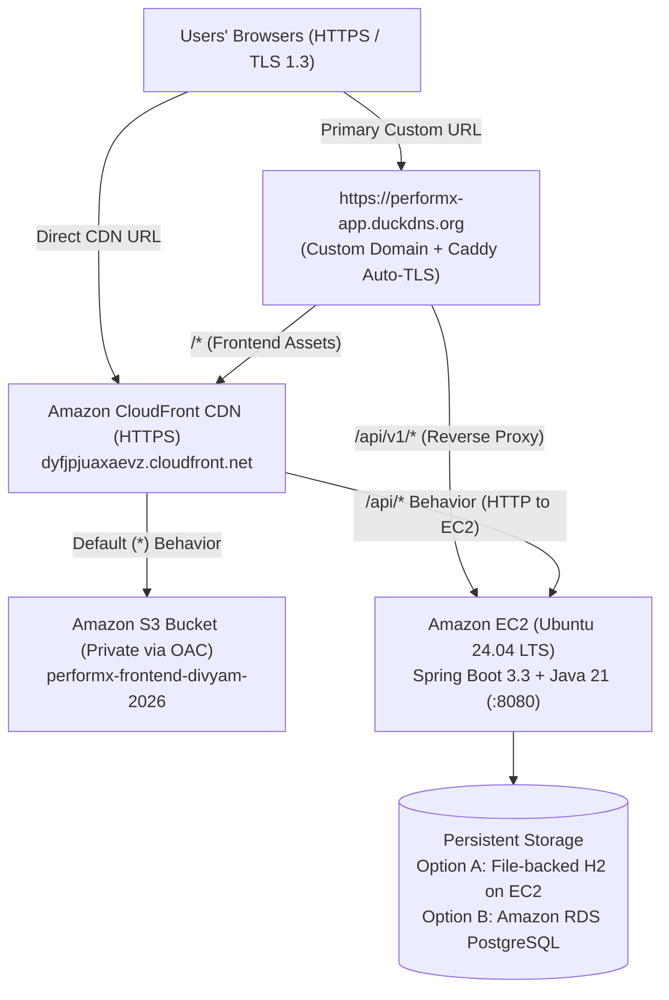

# PerformX — AWS Cloud Architecture & Deployment Guide

This document details the production cloud deployment of **PerformX** on **Amazon Web Services (AWS)** (`us-east-1`), combining **Amazon EC2**, **Amazon S3**, **Amazon CloudFront**, and **Caddy Automated TLS 1.3** on a custom domain.

## 🌐 Live Production Endpoints
- **🚀 Primary Custom Domain (HTTPS / HTTP/3):** **[https://performx-app.duckdns.org](https://performx-app.duckdns.org)**
- **🌍 AWS CloudFront Global CDN (HTTPS):** **[https://dyfjpjuaxaevz.cloudfront.net](https://dyfjpjuaxaevz.cloudfront.net)**
- **🩺 Live API Health Probe:** **[https://performx-app.duckdns.org/api/v1/health](https://performx-app.duckdns.org/api/v1/health)**



---

## What Is Engineered in the Codebase for Cloud Production

1. **Environment-Aware Frontend API Client (`performx-frontend/src/lib/api.js` & `performx-frontend/.env.example`)**:
   - Dynamically reads `import.meta.env.VITE_API_BASE_URL` while defaulting to `/api/v1` so both local Vite proxy, CloudFront `/api/*` behaviors, and Caddy reverse-proxying operate seamlessly over HTTPS without Mixed-Content errors.
2. **Spring Boot Production Profile (`performx-backend/src/main/resources/application-prod.properties`)**:
   - Uses `spring.jpa.hibernate.ddl-auto=update` so application state survives restarts.
   - Persists data on EC2 disk (`jdbc:h2:file:./data/performx;DB_CLOSE_ON_EXIT=FALSE;AUTO_RECONNECT=TRUE`) by default, and supports instant switchover to **Amazon RDS PostgreSQL** via `SPRING_DATASOURCE_URL`, `SPRING_DATASOURCE_USERNAME`, and `SPRING_DATASOURCE_PASSWORD`.
   - Disables `/h2-console` in `prod` profile to harden attack surface.
3. **PostgreSQL Driver (`performx-backend/pom.xml`)**:
   - Includes `org.postgresql:postgresql` runtime dependency for Amazon RDS compatibility.
4. **Dynamic CORS & Health Telemetry (`SecurityConfig.java` & `WorkspaceController.java`)**:
   - Supports environment-driven origin patterns via `CORS_ORIGINS` (`setAllowedOriginPatterns`).
   - Exposes `GET /api/v1/health` returning service status and UTC timestamp for CloudFront / ALB health probes.
5. **Infrastructure-as-Code Scripts (`aws/ec2-setup.sh`, `aws/setup-domain.sh`) & `performx-backend/Dockerfile`**:
   - Automates OpenJDK 21 + Maven installation, JAR packaging, cryptographically random `JWT_SECRET` generation (`/etc/performx.env`), `systemd` daemon registration (`performx.service`), and automated Let's Encrypt TLS provisioning via Caddy.

---

## Step 1 — Backend Deployment on Amazon EC2

### 1.1 EC2 Instance Specifications
- **Instance Name**: `performx-backend` (`i-0948208fdd0b65620`)
- **AMI**: Ubuntu Server 24.04 LTS (HVM), 64-bit (x86)
- **Security Group Inbound Rules**:
  - `22 (SSH)` — Admin access
  - `80 (HTTP)` & `443 (HTTPS)` — Caddy automatic TLS 1.3 & HTTP/3 edge termination
  - `8080 (Custom TCP)` — Spring Boot API origin port for CloudFront
- **Storage**: `15 GiB` `gp3` EBS Volume

### 1.2 Automated 1-Command Provisioning
```bash
git clone https://github.com/Twenitrix/PerformX.git
cd PerformX
chmod +x aws/ec2-setup.sh
./aws/ec2-setup.sh
```

---

## Step 2 — Frontend Deployment on Amazon S3

1. Build the production bundle:
   ```bash
   cd performx-frontend
   npm ci
   npm run build
   ```
2. Upload the contents of `performx-frontend/dist/` (`index.html` and `assets/`) to the private S3 bucket (`performx-frontend-divyam-2026`) with **Block all public access** enabled.

---

## Step 3 — Amazon CloudFront Distribution (`E1FBTCAS8QOT72`)

1. **S3 Origin**: Configured with **Origin Access Control (OAC)** and `Default root object` set to `index.html`.
2. **SPA Deep-Link Routing (`Error pages` tab)**:
   - `403: Forbidden` -> `/index.html` (`200: OK`)
   - `404: Not Found` -> `/index.html` (`200: OK`)
3. **EC2 API Origin & `/api/*` Behavior**:
   - Origin domain: `ec2-34-229-165-211.compute-1.amazonaws.com:8080` (`HTTP only`)
   - Behavior path pattern: `/api/*` -> Allowed methods: `GET, HEAD, OPTIONS, PUT, POST, PATCH, DELETE`, Cache policy: `CachingDisabled`, Origin request policy: `AllViewerExceptHostHeader`.

---

## Step 4 — Custom Domain & Automated TLS 1.3 (`performx-app.duckdns.org`)

1. Map `performx-app.duckdns.org` -> `34.229.165.211` (EC2 Public IPv4).
2. Execute the domain provisioning script on EC2:
   ```bash
   cd ~/PerformX && git pull && chmod +x aws/setup-domain.sh && ./aws/setup-domain.sh performx-app.duckdns.org dyfjpjuaxaevz.cloudfront.net
   ```
   Caddy automatically provisions a Let's Encrypt TLS certificate, routes `/api/*` directly to `localhost:8080`, and proxies all SPA frontend routes to CloudFront (`dyfjpjuaxaevz.cloudfront.net`).

---

## Step 5 — Optional Upgrade to Amazon RDS (PostgreSQL)

Update `/etc/performx.env` on EC2 with your RDS credentials:
```ini
SPRING_DATASOURCE_URL=jdbc:postgresql://<RDS_ENDPOINT>:5432/performx
SPRING_DATASOURCE_USERNAME=postgres
SPRING_DATASOURCE_PASSWORD=<YOUR_RDS_PASSWORD>
```
Then restart the service:
```bash
sudo systemctl restart performx
```
