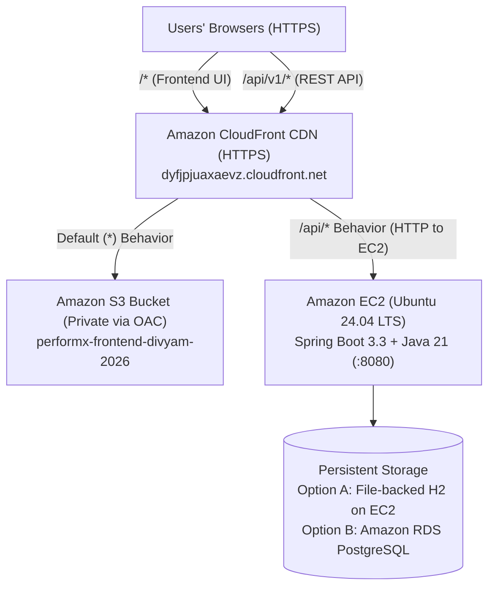

# PerformX — AWS Deployment Guide

This guide walks through deploying **PerformX** to AWS (**Amazon S3 + CloudFront** for the React frontend, **Amazon EC2** for the Spring Boot 3.3 / Java 21 backend, and **Persistent H2 / Amazon RDS PostgreSQL** for the database), with all production edge cases (HTTPS mixed-content, SPA routing, and systemd auto-restart) handled.

## 🌐 Live AWS Production Endpoints
- **Live Web Application (CloudFront HTTPS):** [https://dyfjpjuaxaevz.cloudfront.net](https://dyfjpjuaxaevz.cloudfront.net)
- **Live Backend Health Check:** [https://dyfjpjuaxaevz.cloudfront.net/api/v1/health](https://dyfjpjuaxaevz.cloudfront.net/api/v1/health)



---

## What Is Configured in the Codebase for AWS

1. **Frontend API Client (`performx-frontend/src/lib/api.js` & `performx-frontend/.env.example`)**:
   - Reads `import.meta.env.VITE_API_BASE_URL` (falls back to `/api/v1` so both local Vite proxy and CloudFront `/api/*` routing work out of the box, or you can set a full backend URL in `.env.production`).
2. **Backend Production Profile (`performx-backend/src/main/resources/application-prod.properties` & `application.properties`)**:
   - Uses `spring.jpa.hibernate.ddl-auto=update` so your data is **not wiped** on restart.
   - Defaults to a file-persisted H2 database (`jdbc:h2:file:./data/performx`) on EC2 so demo changes survive restarts immediately, while supporting `SPRING_DATASOURCE_URL`, `SPRING_DATASOURCE_USERNAME`, and `SPRING_DATASOURCE_PASSWORD` environment variables for **Amazon RDS PostgreSQL**.
   - Disables `/h2-console` in `prod` profile for security.
3. **PostgreSQL Driver (`performx-backend/pom.xml`)**:
   - Includes `org.postgresql:postgresql` runtime dependency so the JAR can connect to Amazon RDS PostgreSQL without rebuilding.
4. **CORS & Health Check (`SecurityConfig.java` & `WorkspaceController.java`)**:
   - Supports comma-separated origins and wildcards via `CORS_ORIGINS` (`setAllowedOriginPatterns`).
   - Exposes public `GET /api/v1/health` endpoint for EC2 / CloudFront / ALB health checks.
5. **1-Command EC2 Provisioning Scripts (`aws/ec2-setup.sh`, `aws/setup-domain.sh`) & `performx-backend/Dockerfile`**:
   - Automates Java 21 + Maven installation, JAR packaging, `/etc/performx.env` creation, and a `systemd` service (`performx.service`) so your backend runs 24/7 in the background even after you close SSH.

---

## Step 1 — Deploy the Backend to Amazon EC2

### 1.1 Launch the EC2 Instance
1. Open the **Amazon EC2 Console** (`https://console.aws.amazon.com/ec2/`) and click **Launch instance**.
2. **Name**: `performx-backend`
3. **AMI (OS Image)**: Select **Ubuntu Server 24.04 LTS** (64-bit x86).
4. **Instance type**: Select `t2.micro` or `t3.micro` (Free Tier eligible).
5. **Key pair (login)**: Create a new RSA `.pem` key pair named `performx-key`.
6. **Network settings (Security Group)**:
   - Allow **SSH (port 22)** from your IP
   - Allow **Custom TCP (port 8080)** from `Anywhere-IPv4` (`0.0.0.0/0`)
   - *(Optional for custom domain via Caddy)* Allow **HTTP (port 80)** and **HTTPS (port 443)** from `Anywhere-IPv4` (`0.0.0.0/0`)
7. **Configure storage**: `15 GiB` `gp3`.
8. Click **Launch instance**.

### 1.2 Connect to EC2 & Run Automated Setup
SSH into your EC2 instance and run:

```bash
git clone https://github.com/Twenitrix/PerformX.git
cd PerformX
chmod +x aws/ec2-setup.sh
./aws/ec2-setup.sh
```

---

## Step 2 — Build & Upload the Frontend to Amazon S3

1. Build the React frontend:
   ```bash
   cd performx-frontend
   npm ci
   npm run build
   ```
2. Create a private S3 bucket (`performx-frontend-divyam-2026`) with **Block all public access** enabled.
3. Upload the contents of `performx-frontend/dist/` (`index.html` and `assets/`) to the root of the S3 bucket.

---

## Step 3 — Configure CloudFront (HTTPS + `/api/*` Proxy + React Router Fix)

1. **Frontend Origin**: Create a CloudFront distribution pointing to your S3 bucket using **Origin Access Control (OAC)** and set **Default root object** to `index.html`.
2. **SPA Deep Links (`Error pages` tab)**:
   - Map `403: Forbidden` -> `/index.html` with `200: OK`
   - Map `404: Not Found` -> `/index.html` with `200: OK`
3. **Backend Origin & `/api/*` Behavior**:
   - Create a second Origin pointing to your EC2 Public DNS (`ec2-34-229-165-211.compute-1.amazonaws.com`), Protocol `HTTP only`, Port `8080`.
   - Create a Behavior for path pattern `/api/*` pointing to the EC2 origin, Allowed HTTP methods `GET, HEAD, OPTIONS, PUT, POST, PATCH, DELETE`, Cache policy `CachingDisabled`, and Origin request policy `AllViewerExceptHostHeader`.

---

## Step 4 — Optional Custom Domain Setup (DuckDNS + Caddy Automatic HTTPS)

To serve the application on a custom domain such as `https://performx-app.duckdns.org`:
1. Point your DuckDNS domain to your EC2 Public IPv4 (`34.229.165.211`).
2. Ensure ports `80` and `443` are open in the EC2 Security Group.
3. Run on EC2:
   ```bash
   cd ~/PerformX && git pull && chmod +x aws/setup-domain.sh && ./aws/setup-domain.sh performx-app.duckdns.org
   ```

---

## Step 5 — Optional Upgrade: Switch Database to Amazon RDS (PostgreSQL)

Edit `/etc/performx.env` on your EC2 instance:
```ini
SPRING_DATASOURCE_URL=jdbc:postgresql://<RDS_ENDPOINT>:5432/performx
SPRING_DATASOURCE_USERNAME=postgres
SPRING_DATASOURCE_PASSWORD=<YOUR_RDS_PASSWORD>
```
Then restart the service:
```bash
sudo systemctl restart performx
```
