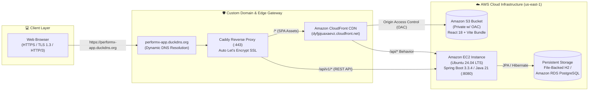

<div align="center">

# ⚡ PERFORMX
### Enterprise Employee Performance Management System (EPMS)
*Manage work. Measure performance. Build better teams.*

[](https://performx-app.duckdns.org)
[](https://dyfjpjuaxaevz.cloudfront.net)
[-10B981?style=for-the-badge&logo=springboot&logoColor=white)](https://performx-app.duckdns.org/api/v1/health)
[-6DB33F?style=for-the-badge&logo=springboot&logoColor=white)](https://spring.io/projects/spring-boot)
[](https://react.dev/)

</div>

---

## 🌐 Live Cloud Production Environment (AWS)

PERFORMX is deployed on **Amazon Web Services (AWS)** (`us-east-1` N. Virginia) using a multi-tier, zero-trust cloud architecture with automated TLS/HTTPS termination, HTTP/3 support, and CI/CD build verification.

| Environment Tier | Live Endpoint / Resource | Underlying Infrastructure |
| :--- | :--- | :--- |
| **🚀 Primary Production App** | **[https://performx-app.duckdns.org](https://performx-app.duckdns.org)** | Custom DNS (`DuckDNS`) + Automated Let's Encrypt TLS 1.3 (`Caddy` Edge Proxy on AWS EC2) |
| **🌍 Global Edge CDN Mirror** | **[https://dyfjpjuaxaevz.cloudfront.net](https://dyfjpjuaxaevz.cloudfront.net)** | **Amazon CloudFront** Edge Distribution (`E1FBTCAS8QOT72`) + Private **Amazon S3** (`OAC`) |
| **🩺 Live REST API Health Probe** | **[https://performx-app.duckdns.org/api/v1/health](https://performx-app.duckdns.org/api/v1/health)** | **Amazon EC2** (`Ubuntu 24.04 LTS`, `Java 21`, `systemd` auto-healing daemon) |
| **📖 Cloud Architecture Runbook** | **[`AWS_DEPLOYMENT_GUIDE.md`](./AWS_DEPLOYMENT_GUIDE.md)** | End-to-end AWS provisioning scripts (`aws/ec2-setup.sh`, `aws/setup-domain.sh`) & Docker |

---

## 🏗️ Enterprise Cloud Architecture (AWS Multi-Tier Topology)



### Why This Architecture Stands Out:
1. **Zero Mixed-Content & Full TLS 1.3 Encryption**: Traffic to **[https://performx-app.duckdns.org](https://performx-app.duckdns.org)** is encrypted via automated Let's Encrypt TLS certificates with **HTTP/3 (`h3`)** enabled at the edge.
2. **Private S3 Origin with Origin Access Control (OAC)**: The React frontend static assets live in a strictly private Amazon S3 bucket (`performx-frontend-divyam-2026`) that blocks all public access and only serves content signed by Amazon CloudFront.
3. **Self-Healing Backend Daemon (`systemd`)**: The Spring Boot 3.3.4 (Java 21) API runs as a managed Linux service (`performx.service`) on Amazon EC2 with `Restart=always`, surviving instance reboots and crashes automatically.
4. **Stateless JWT Security + Strict RBAC**: Every endpoint under `/api/v1/admin/**`, `/api/v1/supervisor/**`, and `/api/v1/employee/**` is protected by Spring Security 6 filter chains, BCrypt (strength 10) password hashing, and HMAC-SHA384 (`HS384`) signed JWT tokens.

---

## ✨ Core Features & Role-Based Workflows

### 1. Three Distinct Role Portals (Strict Server-Side RBAC)
- **🛡️ System Administrator (`ROLE_ADMIN`)**:
  - Organization-wide KPI telemetry, department velocity comparison, and score distribution analytics.
  - Full user lifecycle provisioning (create users, assign roles/departments, activate/revoke accounts).
  - Security Access Audit Log inspection with **batch log deletion** (exclusive to Admin).
  - Organization-wide Chat Compliance Monitoring with **conversation removal** capability.
  - Interactive **Roles & Permissions Matrix** visualizing platform security boundaries.
- **📊 Supervisor / Engineering Lead (`ROLE_SUPERVISOR`)**:
  - Team performance scorecard, real-time completion rates, and overdue task alerts.
  - Weighted task delegation (`performanceWeight` 1–10, priority levels, expected deliverables, deadlines).
  - Task review workflow with feedback notes and 1-click **"Mark as Reviewed"** verification.
  - Quarterly Performance Evaluations (`Productivity 40%`, `Quality 40%`, `Attendance 20%`) powered by a **Smart AI Feedback Synthesis Engine** (`/api/v1/ai/generate-feedback`).
  - Read-only access to team login audit logs (cannot delete logs).
- **👨‍💻 Employee (`ROLE_EMPLOYEE`)**:
  - Personal KPI dashboard with live weighted performance score calculation.
  - Interactive **0–100% Task Progress Slider** with status notes and completion confirmation dialogs.
  - Multi-quarter performance trend line visualizations (`Recharts`) and supervisor feedback history.
  - Real-time 1-on-1 direct messaging with assigned supervisor.

---

## 🗄️ Normalized Relational Database Schema (ER Diagram Compliant)

PERFORMX implements all **9 relational entities** with strict foreign-key referential integrity:

| Entity / Table | Primary Key | Foreign Keys | Key Attributes & Domain Responsibility |
| :--- | :--- | :--- | :--- |
| **`users`** | `user_id` | — | `name`, `email`, `employee_code`, `password` (BCrypt), `role`, `department`, `phone`, `active`, `created_at` |
| **`admins`** | `admin_id` | `user_id` (1:1) | Administrative profile anchor |
| **`supervisors`** | `supervisor_id` | `user_id` (1:1) | Departmental management anchor |
| **`employees`** | `employee_id` | `user_id` (1:1), `supervisor_id` (N:1) | `joining_date`, `designation`, mapped to reporting supervisor |
| **`tasks`** | `task_id` | `supervisor_id`, `employee_id` | `title`, `description`, `assigned_date`, `due_date`, `priority`, `status`, `progress` (0–100), `performance_weight`, `employee_update`, `supervisor_feedback`, `reviewed`, `completed_at` |
| **`performance`** | `performance_id` | `employee_id`, `supervisor_id` | `review_period`, `productivity_score`, `quality_score`, `attendance_score`, `overall_score`, `rating` (1–5), `comments`, `performance_area`, `review_date` |
| **`login_logs`** | `log_id` | `user_id` | `login_time`, `logout_time`, `ip_address`, `device`, `status` (`SUCCESSFUL`, `FAILED`, `ACTIVE`) |
| **`chats`** | `chat_id` | `sender_id`, `receiver_id` | Direct communication channel metadata (`created_at`, `deleted`) |
| **`messages`** | `message_id` | `chat_id`, `sender_id` | Audit-tracked messages (`message_text`, `sent_at`, `is_read`, `deleted`) |

---

## 🔑 Live Demo Credentials (1-Click Persona Switcher Included)

Open **[https://performx-app.duckdns.org](https://performx-app.duckdns.org)** and either use the **1-Click Demo Persona** buttons on the login screen / top navbar, or sign in manually:

| Persona Role | Full Name | Email / Employee ID | Password | Key Capabilities to Demonstrate |
| :--- | :--- | :--- | :--- | :--- |
| **ADMIN** | System Administrator | `admin@performx.com` / `ADM-1001` | `admin123` | Provision users, delete failed access logs, moderate chats, inspect org analytics |
| **SUPERVISOR** | Marcus Vance | `marcus.vance@performx.com` / `SUP-1003` | `supervisor123` | Assign weighted tasks to Aarav, review completed tasks, generate Smart AI quarterly reviews |
| **EMPLOYEE** | Aarav Sharma | `aarav.sharma@performx.com` / `EMP-1009` | `employee123` | Slide task progress (0–100%), mark tasks complete, view 4-quarter score trends, chat with Marcus |

*(The database automatically seeds **62 realistic users** [2 Admins, 6 Supervisors, 54 Employees], ~300 tasks, 4 quarters of historical reviews, and 30 days of security audit logs on initial boot).*

---

## 🛠️ Technology Stack

| Layer | Technologies Used |
| :--- | :--- |
| **Backend API** | Java 21, Spring Boot 3.3.4 (Web, Data JPA / Hibernate, Security 6, Validation), JJWT 0.12.6 (`HS384`) |
| **Frontend SPA** | React 18, Vite 5, Tailwind CSS 3.4, Recharts, Lucide Icons, Axios (with JWT & 401 interceptors) |
| **Database** | Persistent H2 File Storage (`prod` default on EC2) & PostgreSQL JDBC Driver (Amazon RDS ready) |
| **Cloud & DevOps** | AWS EC2 (Ubuntu 24.04), AWS S3 (OAC), AWS CloudFront CDN, Caddy (Auto TLS 1.3 / HTTP/3), Docker, GitHub Actions CI |

---

## 🏁 Local Development Quick Start

### 1-Click Launch (Windows)
```bat
start-all.bat
```

### Manual Startup
```bash
# Terminal 1 — Spring Boot Backend (http://localhost:8080)
cd performx-backend
mvn spring-boot:run

# Terminal 2 — React Vite Frontend (http://localhost:5173)
cd performx-frontend
npm install
npm run dev
```

---

## 📄 License
This project is licensed under the MIT License.
